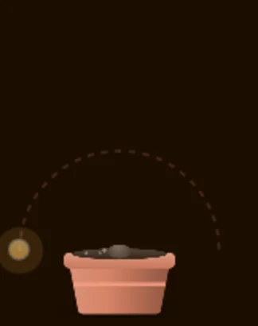
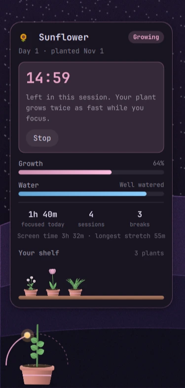
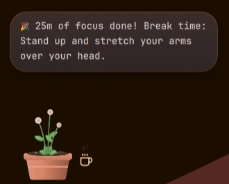
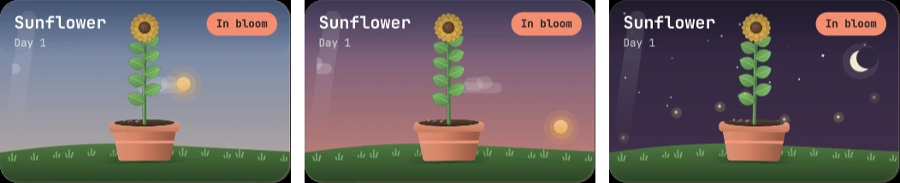
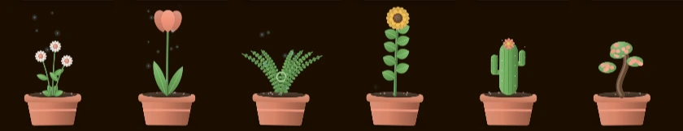
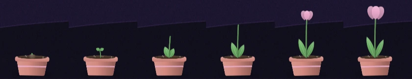
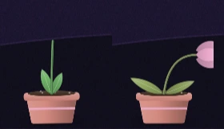

<div align="center">

<picture>
  <source media="(prefers-color-scheme: dark)" srcset="docs/images/banner-dark.svg">
  
</picture>

<br><br>

[](https://omarchy.org)
[](https://quickshell.org)
[](#privacy)
[](LICENSE)

[Install](#install) &nbsp;·&nbsp; [What it does](#what-it-does) &nbsp;·&nbsp; [Use](#use) &nbsp;·&nbsp; [How it grows](#how-it-grows) &nbsp;·&nbsp; [Privacy](#privacy) &nbsp;·&nbsp; [Remove](#remove)

<br>

 &nbsp;&nbsp;


</div>

<br>

Focus Garden is a focus timer that lives in the corner of your screen as a
small potted plant. Start a session and a little sun rises over it and
crosses the sky while you work. Your plant grows with every focused minute,
gets thirsty if you forget to take breaks, and perks right back up when you
step away. Over the weeks, your focused hours become a shelf full of plants.

It's the gentlest productivity tool you'll install: no notifications, no
sounds, no accounts. Just a plant that's doing better when you are.

## What it does

<div align="center">
  
</div>

- **A terrarium in the card:** click the plant and it's there under glass,
  on a little grassy hill, under a sky that follows the time of day: dawn,
  blue day, golden hour, dusk, and a starry night with fireflies.
- **Focus sessions:** start 25, 50 or 90 minutes. A sun rises on the left of
  the glass and sets on the right when you're done, so a glance tells you
  how far along you are. Your plant grows **twice as fast** while you focus.
- **Breaks that mean something:** when a session ends, you get a small, real
  idea for your break: stretch, rest your eyes, refill your water, breathe.
  A steaming cup of coffee waits by the pot until you step away.
- **A plant that needs you to rest:** water drains over about 2.5 hours of
  nonstop work. Your plant droops and fades a little, asks for a break once,
  and gets a drink (with falling water drops) whenever you're away for 5
  minutes.
- **Your day and your week:** focus time, sessions and breaks for today,
  and the last seven days as a row of seedlings, taller the more you
  focused (an hour or more gets a flower). Hover the plant for screen time
  and your longest stretch without a break.
- **Six species to collect:** daisy, tulip, fern, sunflower, cactus and
  bonsai. Each one grows from seed to bloom over a week or two of normal use,
  drawn in code so it grows smoothly and no two look exactly alike. When one
  blooms, it goes on your **shelf** and a new seed is planted.
- **Matches your theme:** flowers wear your Omarchy accent color, the pot is
  warmed by it, and everything follows when you switch themes.
- **Stays out of the way:** it hides during fullscreen apps and never takes
  keyboard focus.

<div align="center">

<br>

<br>

</div>

## Install

Needs **Omarchy 4**. Nothing else: no AI, no API keys, no accounts.

```bash
omarchy plugin add https://github.com/sjdsjadjajdjsa/focus-garden.git --enable
```

Your first seed is planted right away in the bottom-left corner.

## Use

- **Hover** the plant to see how it's doing (and how much focus time is left).
- **Click** it for the card: start a session, see today's stats and your
  shelf. Hover a plant on the shelf to see when it bloomed.
- **From the keyboard:** add these to `~/.config/hypr/bindings.lua`:

```lua
o.bind("SUPER + F12", "Focus 25 minutes", "omarchy-shell garden focus 25")
o.bind("SUPER + SHIFT + F12", "Stop focusing", "omarchy-shell garden stop")
```

## How it grows

| | |
|---|---|
| **Growth** | One step for every minute you're at the computer, two while you focus. A thirsty plant grows at half speed, a parched one not at all. |
| **Water** | Drains over about 2.5 hours of nonstop use and refills while you're away. Five minutes away is a full drink and counts as a break. Watching a video without touching anything counts as away too. |
| **Bloom** | 20 to 45 hours of use, depending on the species. Daisies are quickest, bonsai take their time. |

<div align="center">

</div>

## Privacy

Focus Garden works entirely offline and has no AI in it. It never reads
what's on your screen or what you type; it only notices whether the keyboard
or mouse was used in the last minute. Everything it remembers lives in one
small file, `~/.local/state/focus-garden/state.json`, and the only command it
ever runs is `mkdir -p` for that folder.

## Remove

```bash
omarchy plugin remove cj.focus-garden
rm -rf ~/.local/state/focus-garden   # forget your garden too
```

## For tinkerers

```bash
omarchy-shell garden info                 # how the plant is doing
omarchy-shell garden focus 25             # start a session (1 to 180 minutes)
omarchy-shell garden stop
omarchy-shell garden plantSpecies fern    # start over with a species: daisy tulip fern sunflower cactus bonsai
omarchy-shell garden sky 21.5             # preview the terrarium's sky at 9:30 PM (`sky now` to go back)
```

- **`Garden.qml`** is the heart of the plugin: growing, watering, focus
  sessions and the card. The card's pieces have their own files:
  `Terrarium.qml`, `VineMeter.qml`, `WaterMeter.qml`, `WeekStrip.qml`.
- **`Species.js`** draws the plants. Each species is one small function, so
  adding your own is a good afternoon project.

## Also by cj

- [**Nyx**](https://github.com/sjdsjadjajdjsa/nyx), a little AI buddy that lives in the other corner of your Omarchy desktop
- [**Livewall**](https://github.com/sjdsjadjajdjsa/livewall), any video as your Omarchy wallpaper, from the bar

## License

[MIT](LICENSE). The icons in `Icon.qml` are from [Lucide](https://lucide.dev)
(ISC license; a few derived from Feather, MIT license). Their notices are in
[LICENSE-lucide](LICENSE-lucide).
